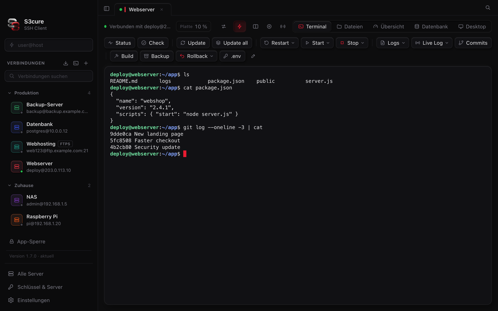
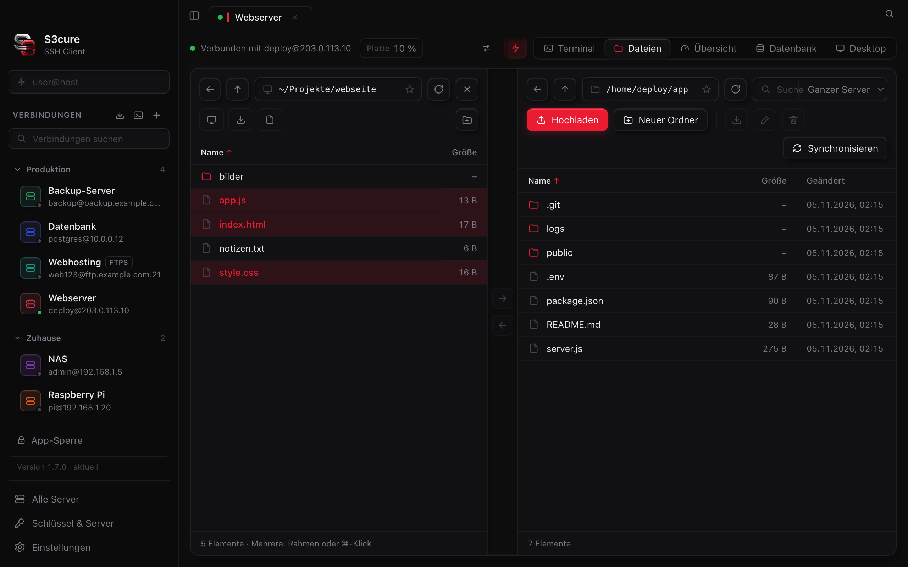
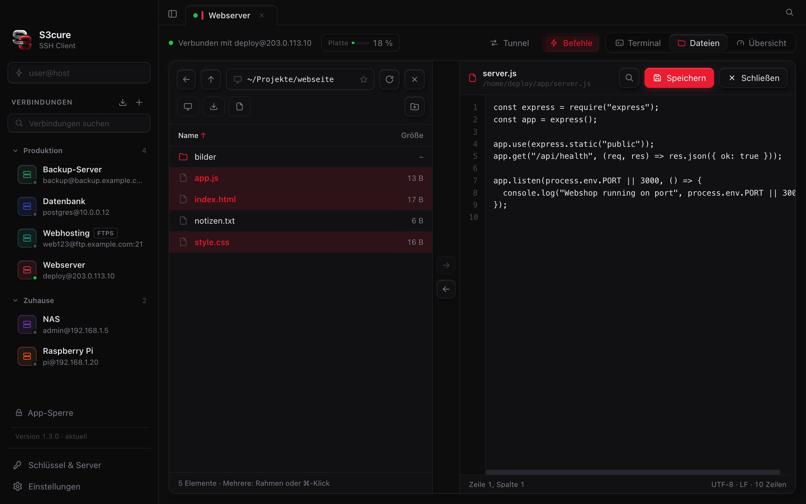
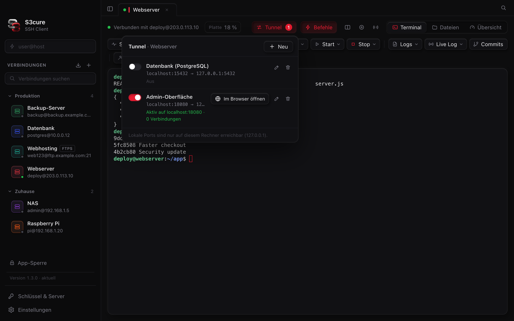

<div align="center">


# S3cure SSH Client

🇬🇧 [English](README.md) · 🇩🇪 **Deutsch**

**Terminal, Dateien, Editor und Tunnel – alles für deine Server in einem Fenster.**<br>
Ein moderner SSH- & SFTP-Client für macOS, Windows und Linux. Kostenlos, Open Source, ohne Konto.

[](https://github.com/s3cureofficial/s3cure-ssh-client/releases/latest)
[](https://github.com/s3cureofficial/s3cure-ssh-client/actions/workflows/build.yml)
[](https://github.com/s3cureofficial/s3cure-ssh-client/releases)
[](#systemanforderungen)
[](LICENSE)

<br>

[](https://github.com/s3cureofficial/s3cure-ssh-client/releases/latest/download/S3cure-SSH-Client-Mac-AppleSilicon.dmg)
[](https://github.com/s3cureofficial/s3cure-ssh-client/releases/latest/download/S3cure-SSH-Client-Mac-Intel.dmg)
[](https://github.com/s3cureofficial/s3cure-ssh-client/releases/latest/download/S3cure-SSH-Client-Setup.exe)
[](https://github.com/s3cureofficial/s3cure-ssh-client/releases/latest/download/S3cure-SSH-Client-Linux-x64.AppImage)

<sub>Ein Klick lädt direkt den Installer der neuesten Version. Alle Versionen: <a href="https://github.com/s3cureofficial/s3cure-ssh-client/releases">Releases</a></sub>

<br><br>



</div>

---

## Inhalt

- [Highlights](#highlights)
- [Screenshots](#screenshots)
- [Installation](#installation)
- [Automatische Updates](#automatische-updates)
- [Was ist neu?](CHANGELOG.md)
- [Alle Funktionen](#alle-funktionen)
- [Tastenkürzel](#tastenkürzel)
- [Sicherheit & Datenschutz](#sicherheit--datenschutz)
- [Häufige Fragen](#häufige-fragen)
- [Selbst bauen](#selbst-bauen)
- [Aufbau & Technik](#aufbau--technik)

## Highlights

<table>
<tr>
<td width="33%" valign="top">

### 🖥️ Terminal
Mehrere Server in Tabs, geteilte Ansicht, Suche, **eigene Befehlsknöpfe** mit Icons und automatisches Neu-Verbinden nach WLAN-Wechsel oder Ruhezustand.

</td>
<td width="33%" valign="top">

### 📁 Dateien
Server und **eigener PC nebeneinander** – Dateien und Ordner einfach hin- und herziehen. Mehrfachauswahl per Rahmen, Vorschau, ZIP, Rechte.

</td>
<td width="33%" valign="top">

### ✏️ Editor
Konfigurationsdateien wie `.env` **direkt auf dem Server bearbeiten** – mit Zeilennummern, Suche und Speichern per Cmd/Strg+S. Kein `nano` mehr nötig.

</td>
</tr>
<tr>
<td valign="top">

### 🔀 Tunnel
Port-Weiterleitung lokal, remote oder als SOCKS-Proxy – z. B. die Datenbank oder eine Admin-Oberfläche sicher auf `localhost` holen.

</td>
<td valign="top">

### 🔐 Sicher
Passwörter verschlüsselt im Schlüsselbund, SSH-Schlüssel erzeugen und übertragen, Host-Schlüssel-Prüfung, optionale **App-Sperre** mit Touch ID.

</td>
<td valign="top">

### 🔄 Immer aktuell
Die App zeigt neue Versionen selbst an – **ein Klick auf „Update“** lädt, prüft und installiert sie. Mit richtigem Installer für Mac und Windows, unter Linux als AppImage.

</td>
</tr>
</table>

## Screenshots

| Server und eigener PC nebeneinander | Dateien direkt auf dem Server bearbeiten |
|:---:|:---:|
|  |  |
| **Port-Weiterleitung (Tunnel)** | **Terminal mit Befehlsknöpfen und Gruppen** |
|  |  |

<sub>Alle Screenshots zeigen Demo-Daten.</sub>

## Installation

| System | Datei | |
|---|---|---|
| **Mac mit Apple-Chip** (M1–M4) | [`S3cure-SSH-Client-Mac-AppleSilicon.dmg`](https://github.com/s3cureofficial/s3cure-ssh-client/releases/latest/download/S3cure-SSH-Client-Mac-AppleSilicon.dmg) | Installationsfenster |
| **Mac mit Intel-Chip** | [`S3cure-SSH-Client-Mac-Intel.dmg`](https://github.com/s3cureofficial/s3cure-ssh-client/releases/latest/download/S3cure-SSH-Client-Mac-Intel.dmg) | Installationsfenster |
| **Windows 10/11** (64 Bit) | [`S3cure-SSH-Client-Setup.exe`](https://github.com/s3cureofficial/s3cure-ssh-client/releases/latest/download/S3cure-SSH-Client-Setup.exe) | Installer mit Startmenü & Desktop-Verknüpfung |
| **Linux** (64 Bit, x86) | [`S3cure-SSH-Client-Linux-x64.AppImage`](https://github.com/s3cureofficial/s3cure-ssh-client/releases/latest/download/S3cure-SSH-Client-Linux-x64.AppImage) | Eine Datei – ausführbar machen und starten |

> [!IMPORTANT]
> Bitte **nicht** „Source code“ bzw. den grünen Knopf „Code → Download ZIP“ benutzen – das ist der Quellcode, kein fertiges Programm.

<details>
<summary><b>🍎 macOS – Schritt für Schritt</b></summary>

1. `.dmg` herunterladen und öffnen.
2. Im Fenster die App auf den Ordner **Programme** ziehen.
3. App aus **Programme** starten. Beim ersten Mal meldet macOS, dass der Entwickler nicht verifiziert werden kann (die App ist nicht kostenpflichtig bei Apple signiert):
   **Systemeinstellungen → Datenschutz & Sicherheit** → ganz unten **Dennoch öffnen**.
4. Fertig. Startest du die App versehentlich von woanders, bietet sie an, sich selbst nach **Programme** zu verschieben.

</details>

<details>
<summary><b>🪟 Windows – Schritt für Schritt</b></summary>

1. `S3cure-SSH-Client-Setup.exe` herunterladen und starten.
2. Erscheint „Der Computer wurde durch Windows geschützt“: **Weitere Informationen** → **Trotzdem ausführen**.
3. Dem Installationsfenster folgen (Installationsordner frei wählbar).
4. Fertig – S3cure findest du im Startmenü und auf dem Desktop. Deinstallieren geht wie gewohnt über **Einstellungen → Apps**.

</details>

<details>
<summary><b>🐧 Linux – Schritt für Schritt</b></summary>

1. `S3cure-SSH-Client-Linux-x64.AppImage` herunterladen und an einen festen Ort legen, z. B. `~/Programme`.
2. Ausführbar machen: Rechtsklick → **Eigenschaften → Als Programm ausführen erlauben**, oder im Terminal:
   `chmod +x S3cure-SSH-Client-Linux-x64.AppImage`
3. Doppelklick bzw. `./S3cure-SSH-Client-Linux-x64.AppImage` startet die App.
4. Startet sie nicht und es erscheint etwas mit **FUSE**: `sudo apt install libfuse2` (Ubuntu 24.04: `libfuse2t64`).
   Meldet sie etwas mit **sandbox** (z. B. unter Ubuntu 24.04): einmal mit `--no-sandbox` starten.

Updates ersetzen die AppImage-Datei an ihrem Ort – dafür braucht der Ordner Schreibrechte. Sonst legt die App die neue Version in **Downloads**.

</details>

### Systemanforderungen

| | Mindestens |
|---|---|
| macOS | 13 Ventura oder neuer – Apple-Chip oder Intel |
| Windows | Windows 10 oder 11, 64 Bit |
| Linux | 64 Bit (x86), z. B. Ubuntu 22.04 / Debian 12 / Fedora 38 oder neuer, mit grafischer Oberfläche |
| Server | jeder SSH-Server (OpenSSH u. a.), SFTP für die Dateiansicht |

## Automatische Updates

Beim Start fragt S3cure bei GitHub nach der neuesten Version. Gibt es eine neuere, steht unten links **„Veraltet“** mit deiner und der neuesten Versionsnummer – ein Klick auf **Update**:

1. lädt die neue Version herunter (Fenster mit Fortschrittsbalken, MB und Geschwindigkeit),
2. prüft sie (Größe, Signatur, Versionsnummer),
3. tauscht die App aus und startet sie neu.

Fehlt etwas oder kann sich die App nicht selbst ersetzen (z. B. fehlende Schreibrechte), lädt sie automatisch den Installer und öffnet ihn (Linux: neue AppImage-Datei in **Downloads**). Ein beschädigtes Paket wird nie installiert – die alte Version bleibt dann erhalten.

Das Update-Fenster zeigt dabei, **was neu** ist, und nach dem ersten Start einer neuen Version erscheint einmal kurz „Was ist neu in x.y.z“. Alle Änderungen stehen in [CHANGELOG.md](CHANGELOG.md).

## Alle Funktionen

<details open>
<summary><b>Terminal</b></summary>

- Mehrere Verbindungen in Tabs, helles und dunkles Design, einklappbare Seitenleiste
- Oberfläche auf **Deutsch und Englisch** – richtet sich nach dem System, umstellbar unter **Einstellungen → Allgemein**
- **Automatisch neu verbinden** nach WLAN-Wechsel, Ruhezustand oder Verbindungsabbruch
- Suche im Terminal, anklickbare Links, Schriftgröße per Tastatur
- **Befehlspalette** (Cmd/Strg+K): Verbindungen, Tabs, Befehlsknöpfe und Aktionen suchen und starten – unscharfe Suche, zuletzt Benutztes oben
- Geteilte Ansicht: bis zu 4 Terminals auf demselben Server – nebeneinander, untereinander oder 2×2, Trenner verschiebbar
- Mitschnitt einer Sitzung als Textdatei
- **An alle senden:** Eingaben gleichzeitig an mehrere Server
- **Eigene Befehlsknöpfe** pro Server – mit Icons, Rückfrage vor gefährlichen Befehlen, Eingabefeldern (`{name}` im Befehl), Ausklappmenüs, Export/Import als JSON – dazu Knöpfe **„Für alle Server“**, die bei jeder Verbindung erscheinen
- Hilfsleiste für `nano` (Speichern & schließen per Klick)
- Server-Übersicht in der Leiste: CPU, RAM, Platte, Laufzeit
- **Übersicht-Ansicht:** Dienste (systemd) und Docker-Container sehen, starten, stoppen, Logs ansehen
- **Befehlspalette** mit Cmd/Strg+K – Verbindungen, Tabs, Befehle und Aktionen per Tastatur
- Bis zu **vier Terminals** in einem Tab, Befehlsknöpfe für alle Server
- **Sitzung wiederherstellen:** nach Neustart oder Update sind Fenster und Tabs wieder da
- **Mehrere Fenster:** Cmd+N (Mac) bzw. Strg+Umschalt+N (Windows/Linux); Tab per Rechtsklick oder durch Herausziehen aus der Tab-Leiste in ein anderes Fenster verschieben – die Verbindung bleibt bestehen
- **Ansicht „Übersicht“:** Dienste (systemd) mit Status, Start/Stop/Neustart und Logs, Docker-Container, große Systemwerte, Laufwerke, Prozesse und die größten Ordner – ohne etwas ins Terminal zu tippen

</details>

<details open>
<summary><b>Dateien (SFTP, FTP, FTPS)</b></summary>

- Dateibrowser mit Hochladen, Herunterladen, Umbenennen, Neuer Ordner, Löschen (mit Rückfrage)
- **„Mein Computer“:** eigene Dateien links, Server rechts – Dateien und ganze Ordner per Ziehen & Ablegen kopieren, mit Rückfrage vor dem Überschreiben
- **Mehrfachauswahl:** Rahmen mit der Maus aufziehen, Cmd/Strg-Klick, Umschalt-Klick, Cmd/Strg+A
- **Eingebauter Editor** mit Zeilennummern und Suche
- Vorschau für Bilder und Text (Leertaste)
- Rechte ändern (chmod), ZIP packen und entpacken
- Live-Suche im Ordner oder über den ganzen Server
- Übertragungsliste: **pausieren, fortsetzen**, abgebrochene Übertragungen weitermachen, mehrere gleichzeitig, Geschwindigkeitslimit
- **Ordner synchronisieren** (Vorschau, Richtung wählbar, Ausschlüsse) und **„Server-Ordner aktuell halten“**
- **Im eigenen Editor bearbeiten** (z. B. VS Code) – Speichern lädt automatisch hoch
- **Dateien vergleichen** – Unterschiede farbig nebeneinander
- **Lesezeichen**, Zurück/Vor, Spalten für Rechte, Besitzer und Gruppe
- **FTP und FTPS** für Webhosting ohne SSH
- „Terminal hier öffnen“

</details>

<details open>
<summary><b>Verbindungen & Sicherheit</b></summary>

- Gespeicherte Verbindungen mit **Gruppen, Farben und Suche**
- Passwort, SSH-Schlüssel (auch mit Passphrase) oder SSH-Agent
- **SSH-Schlüssel erzeugen** und mit einem Klick auf den Server übertragen
- **Schlüssel verwalten:** alle SSH-Schlüssel aus `~/.ssh` mit Typ, Fingerprint und Passphrase-Status – öffentlichen Schlüssel kopieren, im Finder/Explorer zeigen, neuen erzeugen, auf einen Server übertragen
- **Tresor für Zugangsdaten:** Benutzername, Passwort und SSH-Schlüssel (Datei oder im Tresor gespeichert, mit Passphrase) einmal als Eintrag wie „Firmen-Login“ speichern und für viele Verbindungen nutzen – einmal ändern, gilt überall. Starke Passwörter erzeugen, Anzeigen/Kopieren nur auf Wunsch (Zwischenablage wird nach 30 s geleert), auf Wunsch erst nach Entsperren mit App-Passwort oder Touch ID
- Sprung-Server (ProxyJump)
- **Verbindung über Proxy:** SOCKS5 oder HTTP (CONNECT), mit Anmeldung, global oder pro Verbindung – auch zusammen mit Sprung-Server
- **Agent-Weiterleitung** pro Verbindung (z. B. `git pull` auf dem Server mit dem Schlüssel vom eigenen Rechner)
- Import aus `~/.ssh/config`
- **Port-Weiterleitung:** lokal, remote und SOCKS-Proxy – auf Wunsch automatisch beim Verbinden
- **📱 iPhone-App (S3cure Agent):** deine Server unterwegs – Status, Dienste, Docker, Logs (live), Dienste oder den ganzen Server neu starten (mit frischem 2FA-Code), Mitteilungen, wenn etwas ausfällt. Kleiner Agent auf dem Server, HTTPS + Passwort + 2FA, kein App Store nötig → [agent/README.md](agent/README.md)
- **Datenbank-Ansicht (PostgreSQL):** Tabellen ansehen, sortieren und durchsuchen, Zellen ändern und Zeilen löschen (nur über den Primärschlüssel, immer mit Rückfrage), SQL ausführen, CSV-Export – durch den SSH-Tunnel, die Datenbank muss nie offen im Netz sein. Zugangsdaten mit einem Klick aus der `.env` des Servers
- **Sicherheits-Check:** Note A–F pro Server – Root-Anmeldung, Passwort-Anmeldung, Firewall, fail2ban, Updates, automatische Updates, offene Ports (z. B. Datenbank öffentlich), Zertifikate, Uhrzeit. „Beheben“ zeigt den genauen Befehl und führt ihn nach Bestätigung sichtbar im Terminal aus
- **.env-Verwaltung:** findet alle `.env`-Dateien auf dem Server, Werte standardmäßig verdeckt, Vergleich mit `.env.example` (fehlende Schlüssel per Klick), Speichern mit automatischem Backup auf dem Server, Backups zurückholen
- **Lokales Terminal:** ein Tab mit der Konsole des eigenen Computers (zsh/bash, unter Windows PowerShell) direkt neben den Servern – Knopf neben „+“ oder Cmd/Strg+Umschalt+T
- **Alle Server auf einen Blick:** eine Karte pro Server mit CPU, Arbeitsspeicher, Platte und ausgefallenen Diensten, im Hintergrund geprüft; Mitteilung, wenn ein Server ausfällt, die Platte voll wird oder ein Dienst ausfällt
- **Mitteilung, wenn ein langer Befehl fertig ist:** Build oder Update starten, in ein anderes Programm wechseln – S3cure sagt Bescheid, wenn es durch ist
- **Remote Desktop (VNC):** Ansicht „Desktop“ zeigt den Bildschirm des Servers – getunnelt durch die SSH-Verbindung, der VNC-Port muss nicht ins Netz. Anpassen/1:1, Vollbild, Strg+Alt+Entf, Zwischenablage hin und her, „Nur ansehen“, findet laufende VNC-Server auf dem Server und gibt Tipps zum Einrichten (TigerVNC, x11vnc, Raspberry Pi)
- Host-Schlüssel werden beim ersten Verbinden gemerkt und danach geprüft (wie bei OpenSSH); bei einem **geänderten Schlüssel** klare Warnung mit altem und neuem Fingerprint
- **Bekannte Server verwalten:** alle gespeicherten Host-Schlüssel (auch aus `~/.ssh/known_hosts`) ansehen, durchsuchen und einzeln entfernen
- Optionale **App-Sperre** mit Passwort oder Touch ID
- **Schlüssel & Server:** bekannte Server und eigene SSH-Schlüssel verwalten, Warnung bei geändertem Server-Schlüssel
- **Agent-Weiterleitung** und Verbindung über **Proxy** (SOCKS5/HTTP)
- **Backup & Umzug:** alles verschlüsselt exportieren/importieren, optional Abgleich über iCloud/OneDrive

</details>

## Tastenkürzel

| Aktion | macOS | Windows |
|---|---|---|
| Suche im Terminal | <kbd>⌘</kbd> <kbd>F</kbd> | <kbd>Strg</kbd> <kbd>Umschalt</kbd> <kbd>F</kbd> |
| Schrift größer / kleiner / normal | <kbd>⌘</kbd> <kbd>+</kbd> / <kbd>−</kbd> / <kbd>0</kbd> | <kbd>Strg</kbd> <kbd>+</kbd> / <kbd>−</kbd> / <kbd>0</kbd> |
| Befehlspalette (alles suchen und starten) | <kbd>⌘</kbd> <kbd>K</kbd> | <kbd>Strg</kbd> <kbd>K</kbd> |
| Weiteres Terminal daneben (bis zu 4) | <kbd>⌘</kbd> <kbd>D</kbd> | <kbd>Strg</kbd> <kbd>Umschalt</kbd> <kbd>D</kbd> |
| Seitenleiste ein-/ausklappen | <kbd>⌘</kbd> <kbd>B</kbd> | <kbd>Strg</kbd> <kbd>Umschalt</kbd> <kbd>B</kbd> |
| Datei im Editor speichern | <kbd>⌘</kbd> <kbd>S</kbd> | <kbd>Strg</kbd> <kbd>S</kbd> |
| Alle Dateien auswählen | <kbd>⌘</kbd> <kbd>A</kbd> | <kbd>Strg</kbd> <kbd>A</kbd> |
| Vorschau einer Datei | <kbd>Leertaste</kbd> | <kbd>Leertaste</kbd> |

## Sicherheit & Datenschutz

- **Alles bleibt auf deinem Rechner.** Kein Konto, keine Cloud, keine Statistik.
- Verbindungen und Einstellungen liegen in `~/.myssh`, **Passwörter verschlüsselt** im macOS-Schlüsselbund, per Windows-DPAPI bzw. unter Linux über den Schlüsselbund der Oberfläche (GNOME Schlüsselbund, KWallet).
- Die App spricht nur mit deinen Servern – und mit GitHub, um nach neuen Versionen zu schauen.
- Updates werden nur aus diesem Repository geladen und vor der Installation geprüft.
- Tunnel-Ports lauschen nur auf `127.0.0.1` und sind von außen nicht erreichbar.
- Remote Desktop (VNC) läuft immer durch SSH. Die interne Brücke für noVNC lauscht nur auf `127.0.0.1` (zufälliger Port) und nimmt jede Verbindung nur einmal mit einem zufälligen Token an. VNC-Passwörter liegen verschlüsselt wie die anderen Passwörter.

## Häufige Fragen

<details>
<summary><b>macOS sagt, die App sei „beschädigt“ oder „nicht verifiziert“.</b></summary>

Die App ist nicht über das kostenpflichtige Apple-Entwicklerprogramm signiert. „Nicht verifiziert“: **Systemeinstellungen → Datenschutz & Sicherheit → Dennoch öffnen**. Bei „beschädigt“ (passiert bei manchen Download-Programmen):
`xattr -cr "/Applications/S3cure SSH Client.app"` im Terminal ausführen.

</details>

<details>
<summary><b>Wo sind meine Verbindungen gespeichert? Gehen sie bei Updates verloren?</b></summary>

Im Ordner `~/.myssh` (Verbindungen, Befehlsknöpfe, Einstellungen) und im Schlüsselbund (Passwörter). Updates und Neuinstallationen ändern daran nichts.

</details>

<details>
<summary><b>Funktioniert das mit meinem Raspberry Pi / NAS / VPS?</b></summary>

Ja – mit allem, was SSH spricht. Für die Dateiansicht braucht der Server SFTP, das ist bei OpenSSH standardmäßig dabei.

</details>

<details>
<summary><b>Wie deinstalliere ich S3cure?</b></summary>

**macOS:** App aus **Programme** in den Papierkorb ziehen, optional den Ordner `~/.myssh` löschen.
**Windows:** **Einstellungen → Apps → S3cure SSH Client → Deinstallieren**.
**Linux:** Die AppImage-Datei löschen, optional den Ordner `~/.myssh`.

</details>

## Selbst bauen

Voraussetzung: [Node.js](https://nodejs.org) 22 oder neuer.

```bash
git clone https://github.com/s3cureofficial/s3cure-ssh-client.git
cd s3cure-ssh-client/app
npm install
npm start                # App direkt aus dem Quellcode starten
```

Installer bauen (landen in `dist/`):

```bash
npm run build            # macOS Apple Silicon – .dmg
npm run build:mac-intel  # macOS Intel – .dmg
npm run build:win        # Windows – Setup.exe
npm run build:linux      # Linux – AppImage (x64)
```

Tests (Anleitung in [CONTRIBUTING.md](CONTRIBUTING.md)):

```bash
npm test                              # Einheitentests, dauern ein paar Sekunden
xvfb-run -a npm run test:integration  # echte App gegen einen lokalen SSH-Server (Linux)
```

GitHub Actions testet bei jedem Push zuerst (Einheitentests + Integrationstest), baut danach alle vier Versionen und startet Windows-, Mac- und Linux-App zur Probe. Ein Tag `v*` (z. B. `v1.2.0`) veröffentlicht automatisch ein Release mit den Installern und dem passenden Abschnitt aus [CHANGELOG.md](CHANGELOG.md) als Text – die Apps bieten es dann selbst als Update an.

## Aufbau & Technik

| Pfad | Inhalt |
|---|---|
| `app/main.js`, `app/lib/` | Hauptprozess: SSH & SFTP, Tunnel, Updater, Einstellungen |
| `app/src/` | Oberfläche ohne Framework, Terminal mit xterm.js |
| `app/preload.js` | Sichere Brücke zwischen Oberfläche und Hauptprozess |
| `app/tools/` | Build-Skripte (DMG, Windows-Installer, Linux-AppImage, Icons, Release-Text) |
| `app/test/` | Einheitentests (`unit/`) und Integrationstest (`integration/`) mit `node:test` |
| `CHANGELOG.md` | Was ist neu – pro Version, wird zum Release-Text |
| `.github/workflows/` | Automatische Builds und Releases |
| `myssh.py` | Kleines Kommandozeilen-Werkzeug (Python) |

**Gebaut mit:** [Electron](https://www.electronjs.org) · [ssh2](https://github.com/mscdex/ssh2) · [xterm.js](https://xtermjs.org) · [noVNC](https://novnc.com) · [ws](https://github.com/websockets/ws) · [electron-builder](https://www.electron.build) (Installer)

## Lizenz

[MIT](LICENSE) – frei nutzbar, auch für eigene Projekte.

Mitgelieferte Bibliotheken anderer Projekte und ihre Lizenzen (u. a. noVNC unter MPL-2.0): [THIRD_PARTY_NOTICES.md](THIRD_PARTY_NOTICES.md).

<div align="center">
<br>
<br>
<sub>S3cure SSH Client</sub>
</div>
