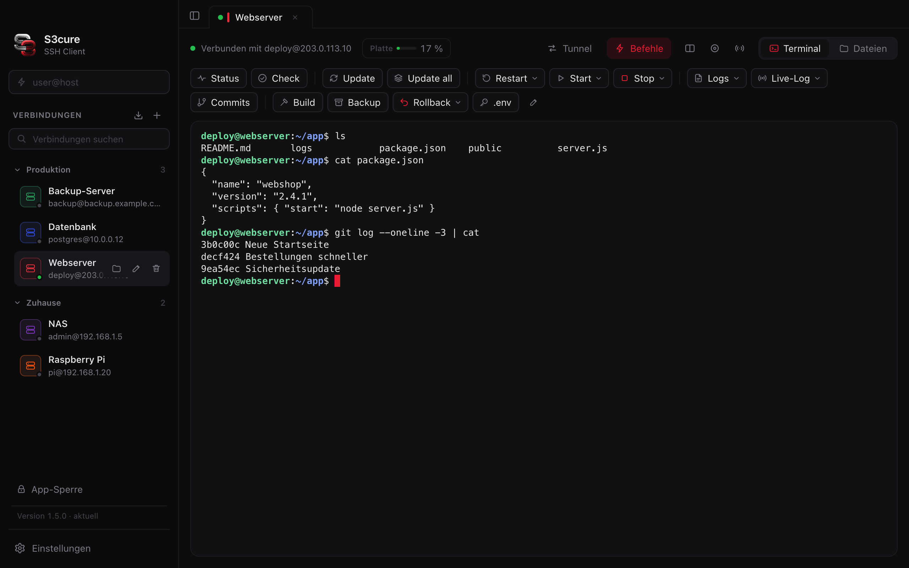
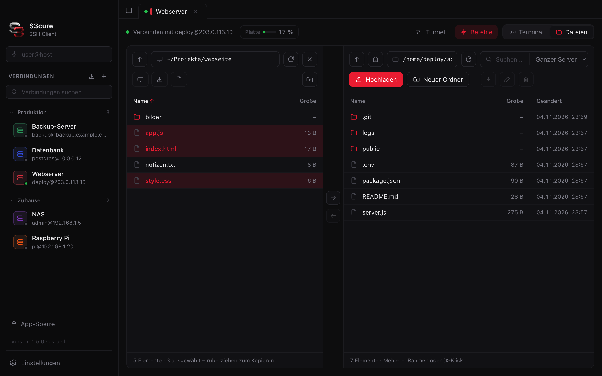
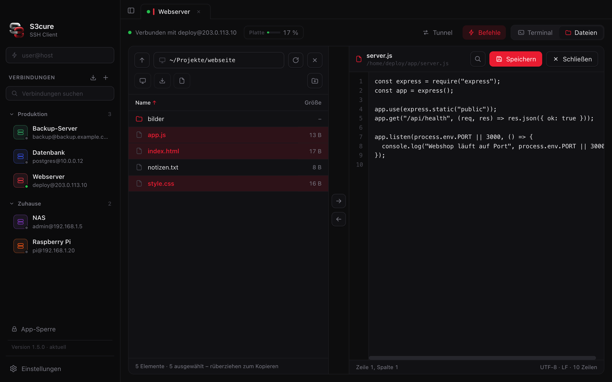
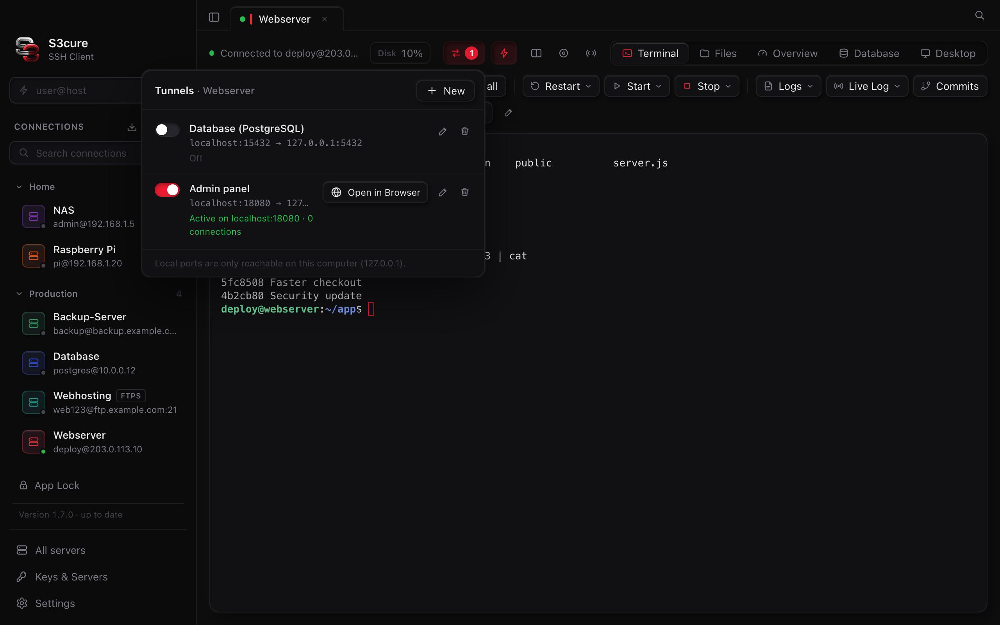

<div align="center">


# S3cure SSH Client

🇬🇧 **English** · 🇩🇪 [Deutsch](README.de.md)

**Terminal, files, editor and tunnels – everything for your servers in one window.**<br>
A modern SSH & SFTP client for macOS, Windows and Linux. Free, open source, no account needed.

[](https://github.com/patrickxypfr-source/s3cure-ssh-client/releases/latest)
[](https://github.com/patrickxypfr-source/s3cure-ssh-client/actions/workflows/build.yml)
[](https://github.com/patrickxypfr-source/s3cure-ssh-client/releases)
[](#system-requirements)
[](LICENSE)

<br>

[](https://github.com/patrickxypfr-source/s3cure-ssh-client/releases/latest/download/S3cure-SSH-Client-Mac-AppleSilicon.dmg)
[](https://github.com/patrickxypfr-source/s3cure-ssh-client/releases/latest/download/S3cure-SSH-Client-Mac-Intel.dmg)
[](https://github.com/patrickxypfr-source/s3cure-ssh-client/releases/latest/download/S3cure-SSH-Client-Setup.exe)
[](https://github.com/patrickxypfr-source/s3cure-ssh-client/releases/latest/download/S3cure-SSH-Client-Linux-x64.AppImage)

<sub>One click downloads the installer for the latest version. All versions: <a href="https://github.com/patrickxypfr-source/s3cure-ssh-client/releases">Releases</a></sub>

<br><br>



</div>

---

## Contents

- [Highlights](#highlights)
- [Screenshots](#screenshots)
- [Installation](#installation)
- [Automatic updates](#automatic-updates)
- [What's New?](CHANGELOG.md)
- [All features](#all-features)
- [Keyboard shortcuts](#keyboard-shortcuts)
- [Security & privacy](#security--privacy)
- [FAQ](#faq)
- [Building from source](#building-from-source)
- [Architecture & tech](#architecture--tech)

## Highlights

<table>
<tr>
<td width="33%" valign="top">

### 🖥️ Terminal
Multiple servers in tabs, split view, search, **custom command buttons** with icons, and automatic reconnect after a Wi-Fi change or sleep.

</td>
<td width="33%" valign="top">

### 📁 Files
Server and **your own computer side by side** – just drag files and folders back and forth. Marquee selection, preview, ZIP, permissions.

</td>
<td width="33%" valign="top">

### ✏️ Editor
**Edit config files like `.env` right on the server** – with line numbers, search and saving via Cmd/Ctrl+S. No more `nano`.

</td>
</tr>
<tr>
<td valign="top">

### 🔀 Tunnels
Port forwarding – local, remote or as a SOCKS proxy. For example, bring your database or an admin panel safely to `localhost`.

</td>
<td valign="top">

### 🔐 Secure
Passwords encrypted in the keychain, generate and install SSH keys, host key verification, optional **App Lock** with Touch ID.

</td>
<td valign="top">

### 🔄 Always up to date
The app tells you about new versions itself – **one click on “Update”** downloads, verifies and installs them. With a proper installer for Mac and Windows, and as an AppImage on Linux.

</td>
</tr>
</table>

## Screenshots

| Server and your own computer side by side | Edit files right on the server |
|:---:|:---:|
|  |  |
| **Port forwarding (Tunnels)** | **Terminal with command buttons and groups** |
|  |  |

<sub>All screenshots show demo data.</sub>

## Installation

| System | File | |
|---|---|---|
| **Mac with Apple silicon** (M1–M4) | [`S3cure-SSH-Client-Mac-AppleSilicon.dmg`](https://github.com/patrickxypfr-source/s3cure-ssh-client/releases/latest/download/S3cure-SSH-Client-Mac-AppleSilicon.dmg) | Install window |
| **Mac with Intel chip** | [`S3cure-SSH-Client-Mac-Intel.dmg`](https://github.com/patrickxypfr-source/s3cure-ssh-client/releases/latest/download/S3cure-SSH-Client-Mac-Intel.dmg) | Install window |
| **Windows 10/11** (64-bit) | [`S3cure-SSH-Client-Setup.exe`](https://github.com/patrickxypfr-source/s3cure-ssh-client/releases/latest/download/S3cure-SSH-Client-Setup.exe) | Installer with Start menu & desktop shortcut |
| **Linux** (64-bit, x86) | [`S3cure-SSH-Client-Linux-x64.AppImage`](https://github.com/patrickxypfr-source/s3cure-ssh-client/releases/latest/download/S3cure-SSH-Client-Linux-x64.AppImage) | A single file – make it executable and run it |

> [!IMPORTANT]
> Please do **not** use “Source code” or the green “Code → Download ZIP” button – that's the source code, not a ready-to-use app.

<details>
<summary><b>🍎 macOS – step by step</b></summary>

1. Download the `.dmg` and open it.
2. In the window, drag the app onto the **Applications** folder.
3. Start the app from **Applications**. The first time, macOS says the developer can't be verified (the app isn't signed through Apple's paid program):
   **System Settings → Privacy & Security** → at the very bottom, **Open Anyway**.
4. Done. If you accidentally start the app from somewhere else, it offers to move itself to **Applications**.

</details>

<details>
<summary><b>🪟 Windows – step by step</b></summary>

1. Download `S3cure-SSH-Client-Setup.exe` and run it.
2. If “Windows protected your PC” appears: **More info** → **Run anyway**.
3. Follow the installer (you can choose the install folder).
4. Done – you'll find S3cure in the Start menu and on the desktop. Uninstall as usual via **Settings → Apps**.

</details>

<details>
<summary><b>🐧 Linux – step by step</b></summary>

1. Download `S3cure-SSH-Client-Linux-x64.AppImage` and put it in a permanent place, e.g. `~/Applications`.
2. Make it executable: right-click → **Properties → Allow executing file as program**, or in the terminal:
   `chmod +x S3cure-SSH-Client-Linux-x64.AppImage`
3. Double-click it or run `./S3cure-SSH-Client-Linux-x64.AppImage` to start the app.
4. If it doesn't start and mentions **FUSE**: `sudo apt install libfuse2` (Ubuntu 24.04: `libfuse2t64`).
   If it mentions **sandbox** (e.g. on Ubuntu 24.04): start it once with `--no-sandbox`.

Updates replace the AppImage file where it is – the folder needs write permission for that. Otherwise the app puts the new version in **Downloads**.

</details>

### System requirements

| | Minimum |
|---|---|
| macOS | 13 Ventura or later – Apple silicon or Intel |
| Windows | Windows 10 or 11, 64-bit |
| Linux | 64-bit (x86), e.g. Ubuntu 22.04 / Debian 12 / Fedora 38 or later, with a desktop environment |
| Server | any SSH server (OpenSSH etc.), SFTP for the file view |

## Automatic updates

On launch, S3cure asks GitHub for the latest version. If there's a newer one, the bottom left shows **“Outdated”** with your version and the latest version number – one click on **Update**:

1. downloads the new version (window with progress bar, MB and speed),
2. verifies it (size, signature, version number),
3. replaces the app and restarts it.

If something is missing or the app can't replace itself (e.g. no write permission), it automatically downloads the installer and opens it (Linux: new AppImage file in **Downloads**). A damaged package is never installed – the old version stays in place.

The update window shows **what's new**, and the first time a new version starts, “What's new in x.y.z” appears briefly once. All changes are listed in [CHANGELOG.md](CHANGELOG.md).

## All features

<details open>
<summary><b>Terminal</b></summary>

- Multiple connections in tabs, light and dark theme, collapsible sidebar
- Interface in **English and German** – follows your system language, can be changed in **Settings → General**
- **Automatic reconnect** after a Wi-Fi change, sleep or dropped connection
- Search in the terminal, clickable links, font size via keyboard
- **Command palette** (Cmd/Ctrl+K): find and run connections, tabs, command buttons and actions – fuzzy search, recently used at the top
- Split view: up to 4 terminals on the same server – side by side, stacked or 2×2, with movable dividers
- Record a session to a text file
- **Send to all:** type into several servers at once
- **Custom command buttons** per server – with icons, confirmation before dangerous commands, input fields (`{name}` in the command), drop-down menus, export/import as JSON – plus **“For all servers”** buttons that appear on every connection
- Helper bar for `nano` (save & exit with one click)
- Server overview in the bar: CPU, RAM, disk, uptime
- **Overview view:** see, start and stop services (systemd) and Docker containers, view logs
- **Command palette** with Cmd/Ctrl+K – connections, tabs, commands and actions via keyboard
- Up to **four terminals** in one tab, command buttons for all servers
- **Restore session:** your tabs are back after a restart or update
- **“Overview” view:** services (systemd) with status, start/stop/restart and logs, Docker containers, large system stats, drives, processes and the largest folders – without typing anything into the terminal

</details>

<details open>
<summary><b>Files (SFTP, FTP, FTPS)</b></summary>

- File browser with upload, download, rename, new folder, delete (with confirmation)
- **“My Computer”:** your files on the left, the server on the right – copy files and whole folders by drag & drop, with confirmation before overwriting
- **Multiple selection:** drag a selection rectangle with the mouse, Cmd/Ctrl-click, Shift-click, Cmd/Ctrl+A
- **Built-in editor** with line numbers and search
- Preview for images and text (Space)
- Change permissions (chmod), create and extract ZIP files
- Live search in the folder or across the whole server
- Transfer list: **pause, resume**, continue interrupted transfers, several at once, speed limit
- **Sync folders** (preview, choose direction, exclusions) and **“Keep server folder up to date”**
- **Edit in your own editor** (e.g. VS Code) – saving uploads automatically
- **Compare files** – differences highlighted side by side
- **Bookmarks**, back/forward, columns for permissions, owner and group
- **FTP and FTPS** for web hosting without SSH
- “Open Terminal Here”

</details>

<details open>
<summary><b>Connections & security</b></summary>

- Saved connections with **groups, colors and search**
- Password, SSH key (also with passphrase) or SSH agent
- **Generate SSH keys** and install them on the server with one click
- **Manage keys:** all SSH keys from `~/.ssh` with type, fingerprint and passphrase status – copy the public key, show in Finder/Explorer, generate a new one, install on a server
- Jump host (ProxyJump)
- **Connect via proxy:** SOCKS5 or HTTP (CONNECT), with login, globally or per connection – also combined with a jump host
- **Agent forwarding** per connection (e.g. `git pull` on the server using the key from your own computer)
- Import from `~/.ssh/config`
- **Port forwarding:** local, remote and SOCKS proxy – optionally started automatically on connect
- Host keys are remembered on first connect and checked from then on (like OpenSSH); if a **key has changed**, you get a clear warning with the old and new fingerprint
- **Manage known servers:** view, search and remove individual saved host keys (including those from `~/.ssh/known_hosts`)
- Optional **App Lock** with password or Touch ID
- **Keys & Servers:** manage known servers and your own SSH keys, warning when a server key changes
- **Agent forwarding** and connecting via **proxy** (SOCKS5/HTTP)
- **Backup & Migration:** export/import everything encrypted, optionally sync via iCloud/OneDrive

</details>

## Keyboard shortcuts

| Action | macOS | Windows |
|---|---|---|
| Search in terminal | <kbd>⌘</kbd> <kbd>F</kbd> | <kbd>Ctrl</kbd> <kbd>Shift</kbd> <kbd>F</kbd> |
| Font bigger / smaller / reset | <kbd>⌘</kbd> <kbd>+</kbd> / <kbd>−</kbd> / <kbd>0</kbd> | <kbd>Ctrl</kbd> <kbd>+</kbd> / <kbd>−</kbd> / <kbd>0</kbd> |
| Command palette (find and run anything) | <kbd>⌘</kbd> <kbd>K</kbd> | <kbd>Ctrl</kbd> <kbd>K</kbd> |
| Another terminal alongside (up to 4) | <kbd>⌘</kbd> <kbd>D</kbd> | <kbd>Ctrl</kbd> <kbd>Shift</kbd> <kbd>D</kbd> |
| Show / hide sidebar | <kbd>⌘</kbd> <kbd>B</kbd> | <kbd>Ctrl</kbd> <kbd>Shift</kbd> <kbd>B</kbd> |
| Save file in editor | <kbd>⌘</kbd> <kbd>S</kbd> | <kbd>Ctrl</kbd> <kbd>S</kbd> |
| Select all files | <kbd>⌘</kbd> <kbd>A</kbd> | <kbd>Ctrl</kbd> <kbd>A</kbd> |
| Preview a file | <kbd>Space</kbd> | <kbd>Space</kbd> |

## Security & privacy

- **Everything stays on your computer.** No account, no cloud, no analytics.
- Connections and settings live in `~/.myssh`, **passwords are encrypted** in the macOS Keychain, via Windows DPAPI, or on Linux via your desktop's keyring (GNOME Keyring, KWallet).
- The app only talks to your servers – and to GitHub to check for new versions.
- Updates are only downloaded from this repository and verified before installing.
- Tunnel ports only listen on `127.0.0.1` and can't be reached from outside.

## FAQ

<details>
<summary><b>macOS says the app is “damaged” or “not verified”.</b></summary>

The app isn't signed through Apple's paid developer program. “Not verified”: **System Settings → Privacy & Security → Open Anyway**. For “damaged” (happens with some download tools):
run `xattr -cr "/Applications/S3cure SSH Client.app"` in the terminal.

</details>

<details>
<summary><b>Where are my connections stored? Will I lose them when updating?</b></summary>

In the `~/.myssh` folder (connections, command buttons, settings) and in the keychain (passwords). Updates and reinstalls don't touch them.

</details>

<details>
<summary><b>Does it work with my Raspberry Pi / NAS / VPS?</b></summary>

Yes – with anything that speaks SSH. For the file view the server needs SFTP, which OpenSSH includes by default.

</details>

<details>
<summary><b>How do I uninstall S3cure?</b></summary>

**macOS:** Drag the app from **Applications** to the Trash, optionally delete the `~/.myssh` folder.
**Windows:** **Settings → Apps → S3cure SSH Client → Uninstall**.
**Linux:** Delete the AppImage file, optionally the `~/.myssh` folder.

</details>

## Building from source

Requirement: [Node.js](https://nodejs.org) 22 or later.

```bash
git clone https://github.com/patrickxypfr-source/s3cure-ssh-client.git
cd s3cure-ssh-client/app
npm install
npm start                # run the app straight from source
```

Build installers (they end up in `dist/`):

```bash
npm run build            # macOS Apple silicon – .dmg
npm run build:mac-intel  # macOS Intel – .dmg
npm run build:win        # Windows – Setup.exe
npm run build:linux      # Linux – AppImage (x64)
```

Tests (guide in [CONTRIBUTING.md](CONTRIBUTING.md)):

```bash
npm test                              # unit tests, take a few seconds
xvfb-run -a npm run test:integration  # real app against a local SSH server (Linux)
```

On every push, GitHub Actions runs the tests first (unit tests + integration test), then builds all four versions and launches the Windows, Mac and Linux apps as a smoke test. A `v*` tag (e.g. `v1.2.0`) automatically publishes a release with the installers and the matching section from [CHANGELOG.md](CHANGELOG.md) as release notes – the apps then offer it as an update themselves.

## Architecture & tech

| Path | Contents |
|---|---|
| `app/main.js`, `app/lib/` | Main process: SSH & SFTP, tunnels, updater, settings |
| `app/src/` | Interface without a framework, terminal with xterm.js |
| `app/preload.js` | Secure bridge between interface and main process |
| `app/tools/` | Build scripts (DMG, Windows installer, Linux AppImage, icons, release notes) |
| `app/test/` | Unit tests (`unit/`) and integration test (`integration/`) with `node:test` |
| `CHANGELOG.md` | What's new – per version, becomes the release notes |
| `.github/workflows/` | Automatic builds and releases |
| `myssh.py` | Small command-line tool (Python) |

**Built with:** [Electron](https://www.electronjs.org) · [ssh2](https://github.com/mscdex/ssh2) · [xterm.js](https://xtermjs.org) · [electron-builder](https://www.electron.build) (installer)

## License

[MIT](LICENSE) – free to use, including for your own projects.

<div align="center">
<br>
<br>
<sub>S3cure SSH Client</sub>
</div>
